# Capítulo 1: Introducción a Git y Configuración Inicial

## 1. Descarga e Instalación de Git
A continuación se muestran los pasos para la descarga, ejecución del instalador y verificación de Git en Windows.

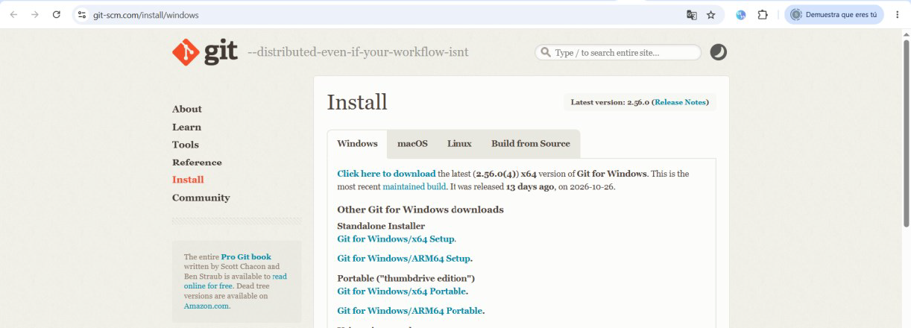
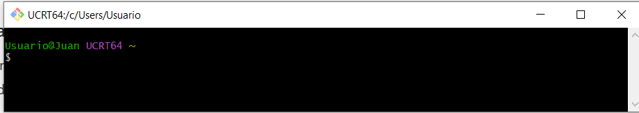
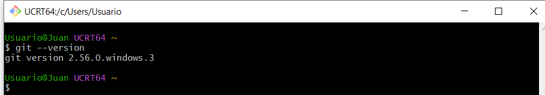

Verificación de la versión instalada en la terminal:
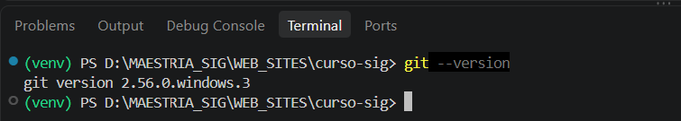
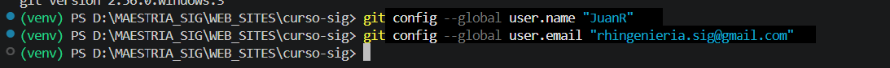

---

## 1.2 Configuración Inicial de Git
Configuración de identidad (usuario y correo electrónico) y del editor predeterminado en Visual Studio Code.

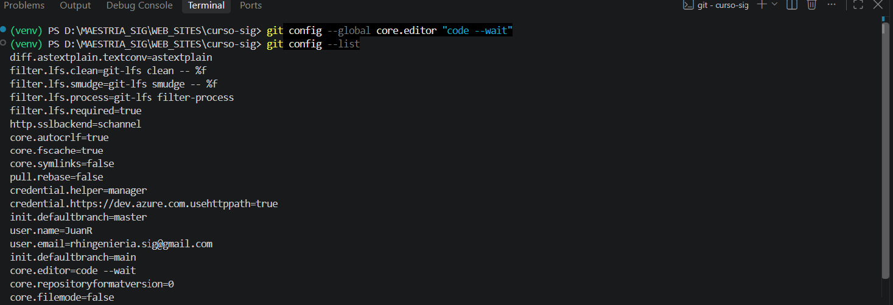
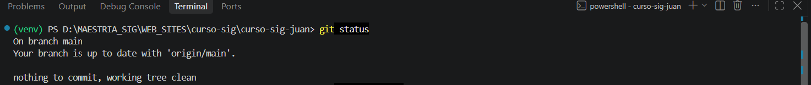

---

## 1.3 Creación de Notas y Archivos de Trabajo
Proceso de creación del archivo `notas.txt` a través de la consola de Visual Studio Code y control de versiones adaptado a datos espaciales.

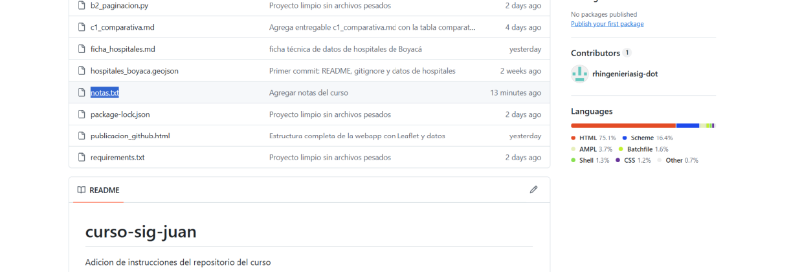
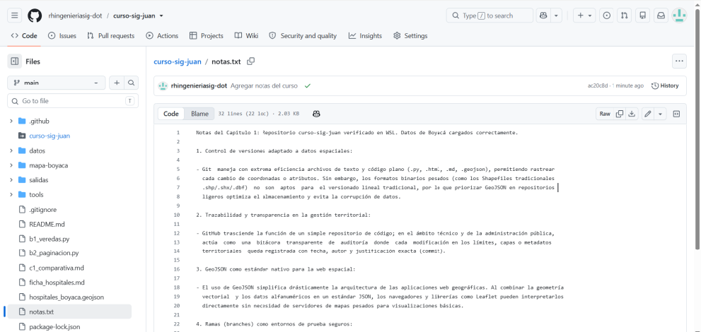
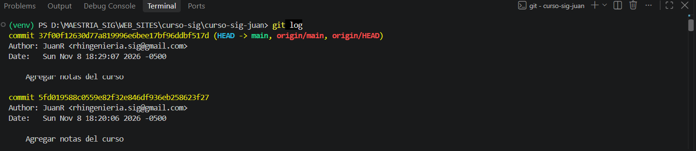
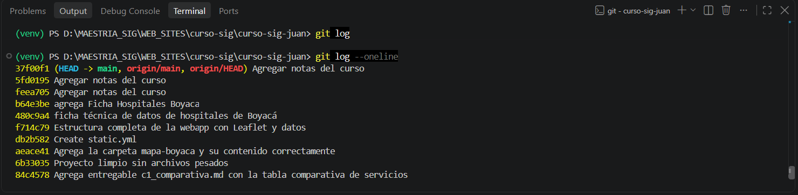
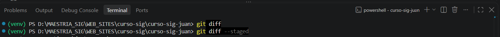

---

## 1.4 Ejercicio Práctico: Clonación y Flujo de Trabajo
Clonación del repositorio en la máquina local y validación del directorio de trabajo.

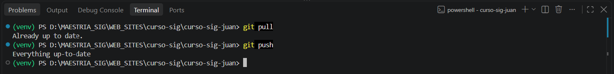
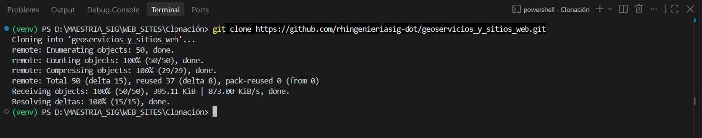
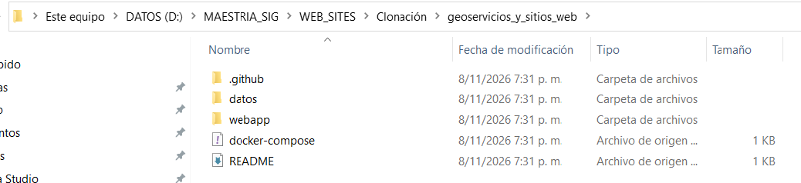
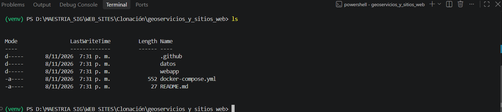
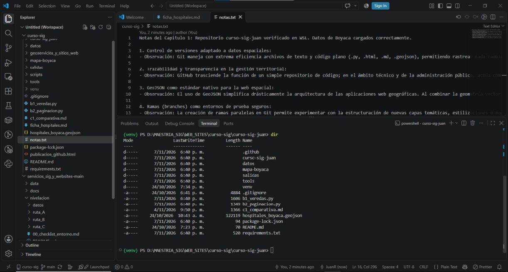
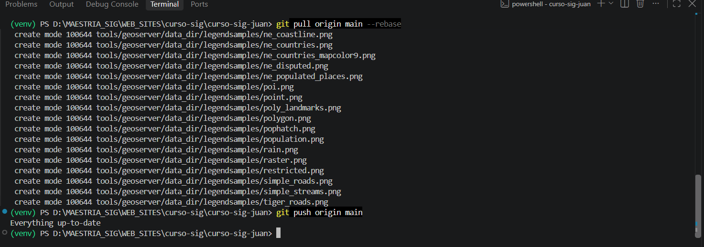
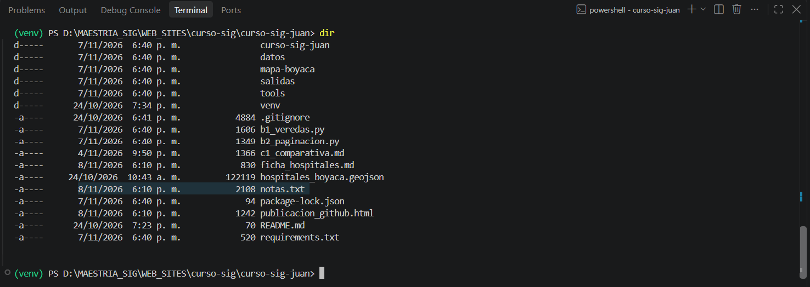
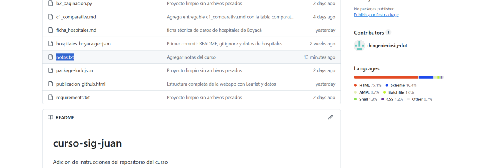

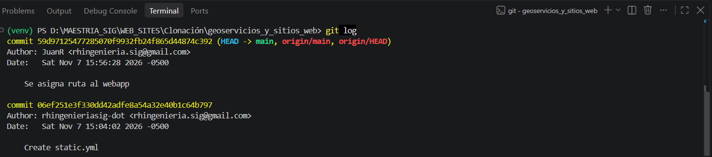