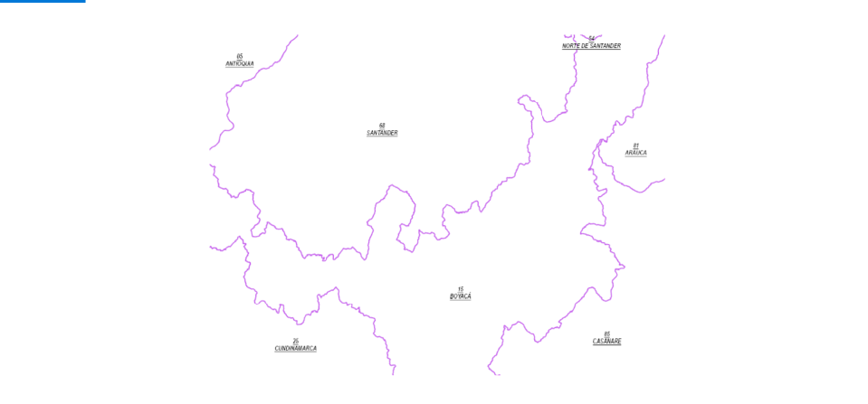
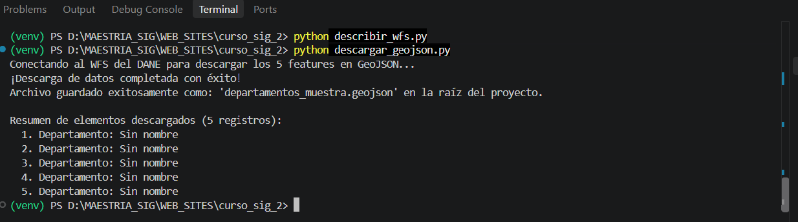
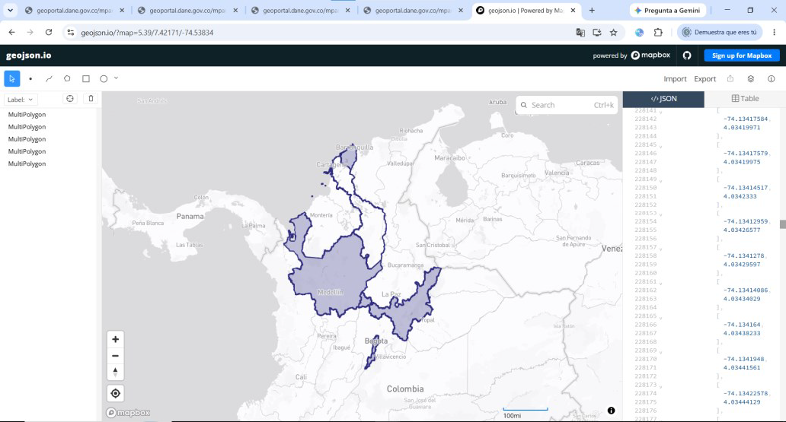
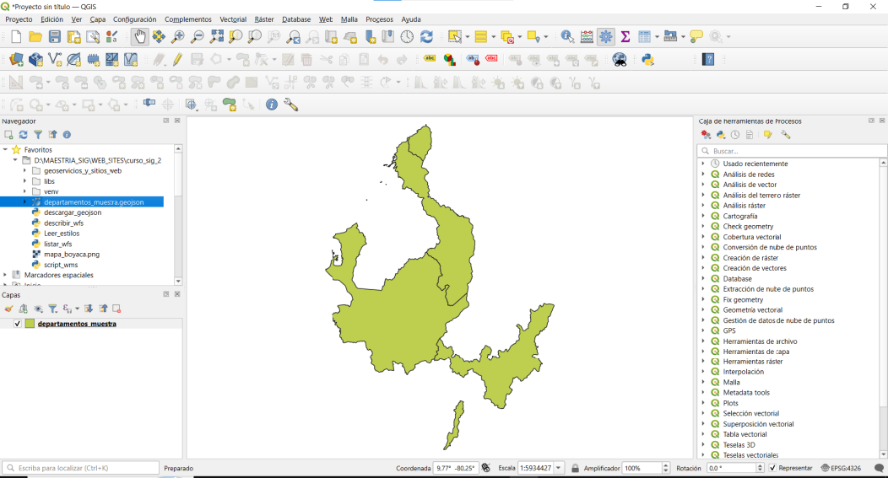
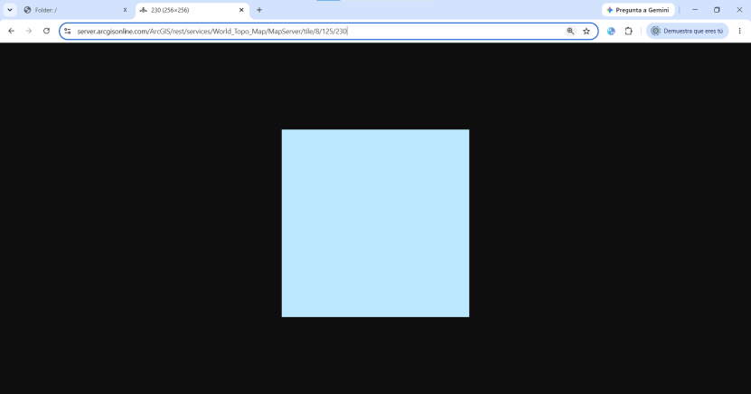
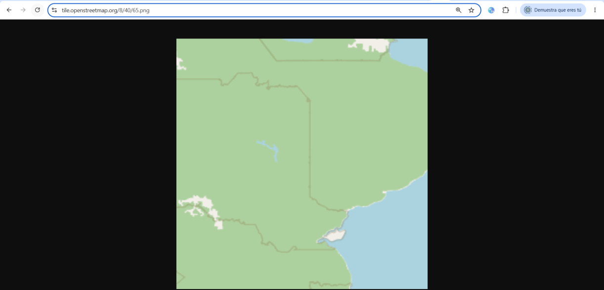

# **Ficha de Operaciones OGC (`operaciones-ogc.md`)**

## **1. WMS — `GetCapabilities` (Servicios DANE / IDE Boyacá)**

A través de la petición de capacidades del servicio WMS del DANE (`.../MapServer/WMSServer?service=WMS&request=GetCapabilities`), se identificaron las siguientes dos capas clave para el departamento de Boyacá:

* **Capa 1:** `Serv_CapasMGN_2024:Departamento`
  * **CRS soportados:** `EPSG:4326`, `EPSG:3857`, `EPSG:3116` (Magna-Sirgas / Origen Nacional).
  * **Formatos soportados:** `image/png`, `image/jpeg`, `image/png8`.
  * *Verificación:* Visible en la sección `<Layer>` del XML devuelto por el servidor WMS.

* **Capa 2:** `Serv_CapasMGN_2024:Municipio`
  * **CRS soportados:** `EPSG:4326`, `EPSG:3857`, `EPSG:3116`.
  * **Formatos soportados:** `image/png`, `image/jpeg`, `image/png8`.
  * *Verificación:* Confirmado mediante la etiqueta `<Format>` dentro de los metadatos de la capa municipal.

---

## **2. WMS — `GetMap` (Área de Boyacá)**

Petición HTTP construida para renderizar una imagen rasterizada centrada en el departamento de Boyacá utilizando el sistema de referencia espacial `EPSG:4326` (WGS 84):

`https://geoportal.dane.gov.co/mparcgis/services/MGN2024/Serv_CapasMGN_2024/MapServer/WMSServer?service=WMS&version=1.3.0&request=GetMap&layers=Serv_CapasMGN_2024:Departamento&styles=&bbox=4.5,-74.5,7.0,-71.8&width=800&height=600&crs=EPSG:4326&format=image/png`

**Captura de pantalla:** La imagen generada (`mapa_boyaca.png`) se encuentra almacenada en la carpeta de evidencias del capítulo.

---

## **3. WFS — `GetFeature` (Consulta Filtrada a GeoJSON)**

Extracción de entidades geográficas mediante una petición WFS filtrada por atributos o cuadro delimitador (`bbox`) con formato de salida GeoJSON.

`https://geoportal.dane.gov.co/mparcgis/services/MGN2024/Serv_CapasMGN_2024/MapServer/WFSServer?service=WFS&version=2.0.0&request=GetFeature&typeNames=Serv_CapasMGN_2024:Departamento&count=5&outputFormat=GEOJSON`

Para almacenar este resultado directamente en la carpeta de trabajo y poder abrirlo luego en QGIS o inspectores de código, se procesa mediante scripts automatizados.

* **Conteo de features obtenido:** 5 entidades de tipo polígono correspondientes a los departamentos consultados en la muestra.
* *Verificación:* El archivo `departamentos_muestra.geojson` procesado mediante scripts de Python o QGIS valida la estructura correcta de los objetos geográficos en formato JSON.

También podemos elaborar la consulta gráfica del archivo geojson a través de [geojson.io](https://geojson.io/). Pegando el archivo en su interfaz:

Al verificar el archivo que se descargó en QGIS tenemos:

---

## **4. WMTS / Teselas (Estructura `Z/X/Y` o `GetTile`)**

Consulta de una tesela ráster individual orientada al sistema de caché web (WMTS):

`https://server.arcgisonline.com/ArcGIS/rest/services/World_Topo_Map/MapServer/tile/{z}/{y}/{x}`

* **URL de la tesela solicitada:** `https://server.arcgisonline.com/ArcGIS/rest/services/World_Topo_Map/MapServer/tile/8/125/230`
* **Parámetros de navegación:** Nivel de zoom (Z): `8` | Fila (Y): `125` | Columna (X): `230`
* *Verificación:* La tesela devuelve un mosaico de imagen PNG de 256x256 píxeles correspondiente a la proyección ráster almacenada en el servidor para esa coordenada espacial exacta.

Adicionalmente, utilizando el servidor oficial de teselas ráster de OpenStreetMap (`https://tile.openstreetmap.org/`):
* Nivel de Zoom (`8`): Nivel de ampliación o escala cartográfica regional.
* Columna o Eje X (`40`): Coordenada horizontal de la tesela dentro de la cuadrícula global.
* Fila o Eje Y (`65`): Coordenada vertical de la tesela dentro de la cuadrícula global.
* Formato de Archivo (`.png`): Formato de imagen ráster estática de 256x256 píxeles.

