# **Capítulo 5: Servicios Web Geográficos**

**Paso 1\. Acceder al WMS GetCapabilities de tu GeoServer local**

El documento `GetCapabilities` es el contrato XML que describe todos los servicios, capas y estilos disponibles en el servidor WMS.

1\.      Nos aseguramos de tener GeoServer encendido en la terminal de Ubuntu/WSL.

Se abre una terminal y se inicia a través de:  *sudo dockerd*

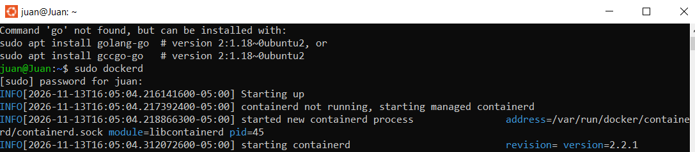

En otra terminal se ejecuta lo siguiente:

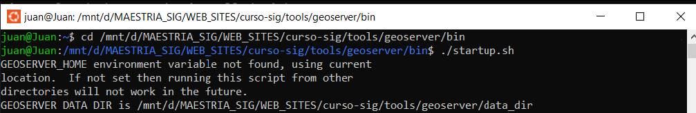

Se hace de esta manera ya que en dicha ruta se habían instalado los programas necesarios, para el caso el Geo Server de manera nativa.

2\.     Se abre el navegador web en Windows y se ingresa a la siguiente URL:

[http\://localhost:8080/geoserver/wms?service=WMS\&version=1.3.0\&request=GetCapabilities](http://localhost:8080/geoserver/wms?service=WMS&version=1.3.0&request=GetCapabilities)

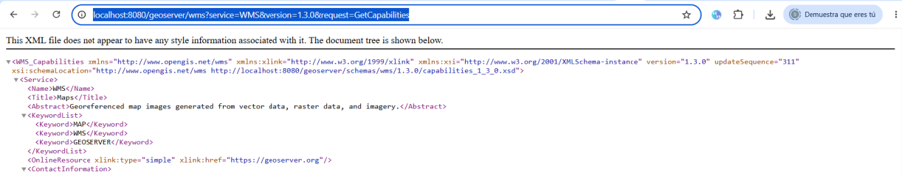

**Paso 2\. Identificar una capa de ejemplo (sf:states)**

Revisando el XML identificamos la capa clásica de demostración de polígonos de Estados Unidos (datos de población):

·        **Nombre de la capa:** `sf:states` (perteneciente al espacio de trabajo `sf`).

·        **Sistemas de referencia soportados:** `EPSG:4326`, `EPSG:3857`, entre otros.

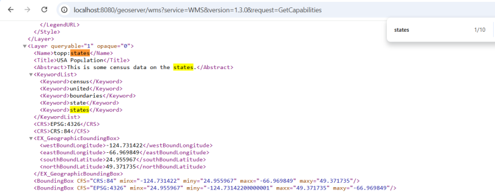

**Paso 3\. Construye una petición GetMap para visualizar esa capa**

URL:

[http\://localhost:8080/geoserver/topp/wms?service=WMS\&version=1.3.0\&request=GetMap\&layers=topp%3Astates\&bbox=-124.73142200000001%2C24.955967%2C-66.969849%2C49.371735\&width=800\&height=400\&srs=EPSG%3A4326\&styles=\&format=application/openlayers](http://localhost:8080/geoserver/topp/wms?service=WMS&version=1.3.0&request=GetMap&layers=topp%3Astates&bbox=-124.73142200000001%2C24.955967%2C-66.969849%2C49.371735&width=800&height=400&srs=EPSG%3A4326&styles=&format=application/openlayers)

Para verificar lo anterior, se conecta el servicio en QGIS:

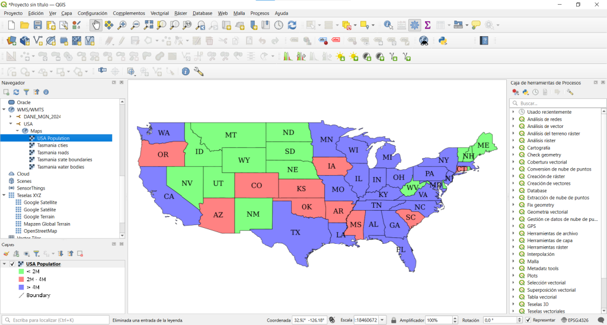 

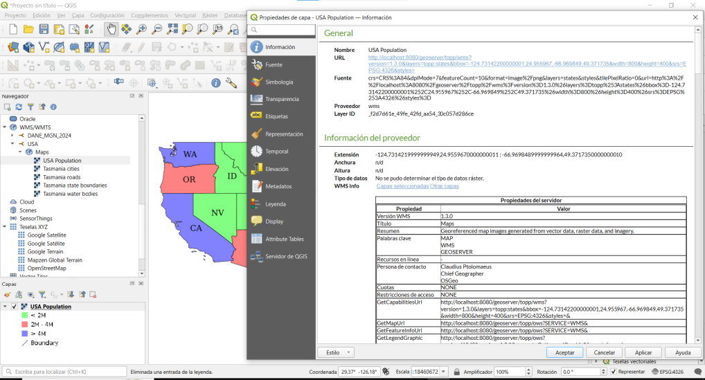

Igualmente también se puede verificar el servicio a través del navegador:

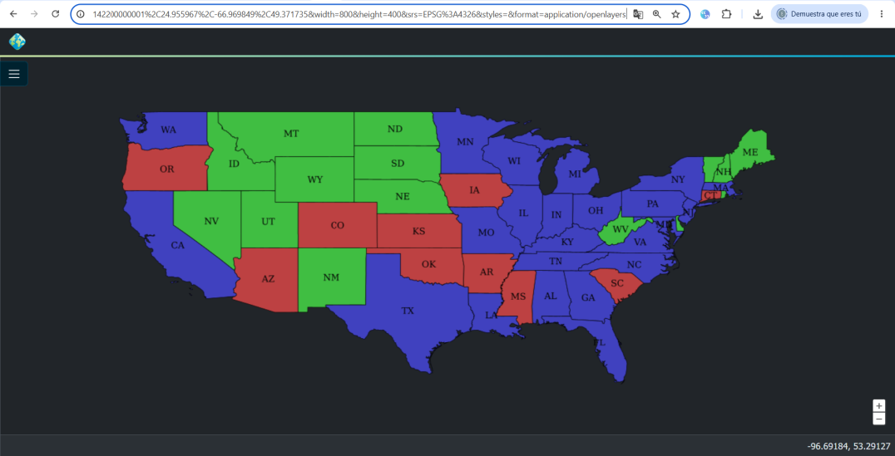 

**Paso 4\. Ejecuta una petición GetFeatureInfo en un punto del mapa**

**QGIS**

Results for FeatureType '[http\://www\.openplans.org/topp:states](http://www.openplans.org/topp:states)':

\--------------------------------------------

   
   
   
   
**states**

| FeatureID | states.8 |  |  |
| :---: | :---- | :---- | :---- |
| **STATE\_NAME** | Kansas | **WORKERS** | 907383.0 |
| **STATE\_FIPS** | 20 | **DRVALONE** | 928575.0 |
| **SUB\_REGION** | W N Cen | **CARPOOL** | 135598.0 |
| **STATE\_ABBR** | KS | **PUBTRANS** | 7585.0 |
| **LAND\_KM** | 211921.641 | **EMPLOYED** | 1172214.0 |
| **WATER\_KM** | 1188.865 | **UNEMPLOY** | 57772.0 |
| **PERSONS** | 2477574.0 | **SERVICE** | 346339.0 |
| **FAMILIES** | 658600.0 | **MANUAL** | 166429.0 |
| **HOUSHOLD** | 944726.0 | **P\_MALE** | 0.49 |
| **MALE** | 1214645.0 | **P\_FEMALE** | 0.51 |
| **FEMALE** | 1262929.0 | **SAMP\_POP** | 453411.0 |

 

 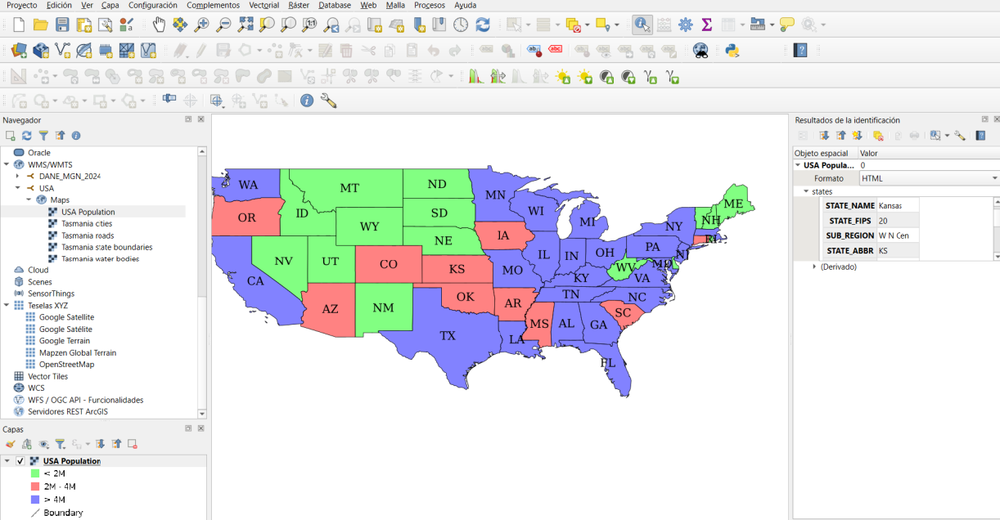

 

También se puede elaborar la consulta directamente en OpenLayeres:

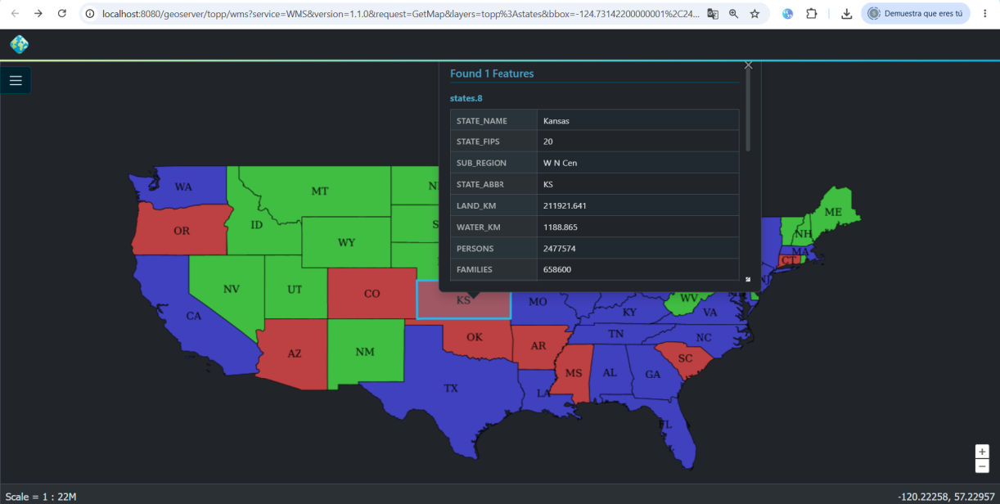

#### **Found 1 Features**

**states.8**

| STATE\_NAME | Kansas | WORKERS | 907383 |
| :---- | :---- | :---- | :---- |
| **STATE\_FIPS** | 20 | **DRVALONE** | 928575 |
| **SUB\_REGION** | W N Cen | **CARPOOL** | 135598 |
| **STATE\_ABBR** | KS | **PUBTRANS** | 7585 |
| **LAND\_KM** | 211921.641 | **EMPLOYED** | 1172214 |
| **WATER\_KM** | 1188.865 | **UNEMPLOY** | 57772 |
| **PERSONS** | 2477574 | **SERVICE** | 346339 |
| **FAMILIES** | 658600 | **MANUAL** | 166429 |
| **HOUSHOLD** | 944726 | **P\_MALE** | 0.49 |
| **MALE** | 1214645 | **P\_FEMALE** | 0.51 |
| **FEMALE** | 1262929 | **SAMP\_POP** | 453411 |

 

 **Paso 5\. Accede al WFS GetCapabilities**

A diferencia del WMS (que devuelve imágenes), el WFS (*Web Feature Service*) expone la geometría y los atributos vectoriales puros.

URL:

[http\://localhost:8080/geoserver/wfs?service=WFS\&version=2.0.0\&request=GetCapabilities](http://localhost:8080/geoserver/wfs?service=WFS&version=2.0.0&request=GetCapabilities)

**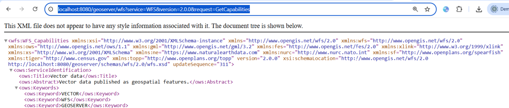**

**Paso 6\. Ejecuta un GetFeature para obtener datos en GeoJSON**

Esta petición extrae directamente los objetos vectoriales de la base de datos en formato abierto `GeoJSON`.

1\.     Se copia y pega esta la URL en el navegador (descargará o mostrará un JSON con las entidades de la capa):

URL:   
 

[http\://localhost:8080/geoserver/wfs?service=WFS\&version=1.0.0\&request=GetFeature\&typeName=topp:states\&outputFormat=application/json](http://localhost:8080/geoserver/wfs?service=WFS&version=1.0.0&request=GetFeature&typeName=topp:states&outputFormat=application/json)

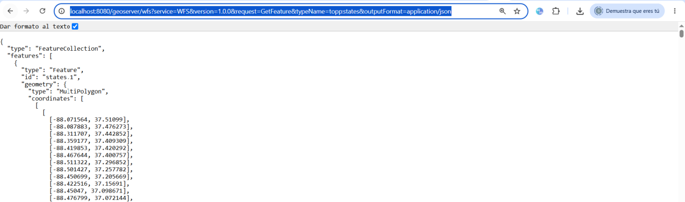Visualización del archivo estructurado en texto/JSON con las coordenadas de los polígonos.

Podemos verificar gráficamente el geojson en la pagina [https\://geojson.io/](https://geojson.io/)  

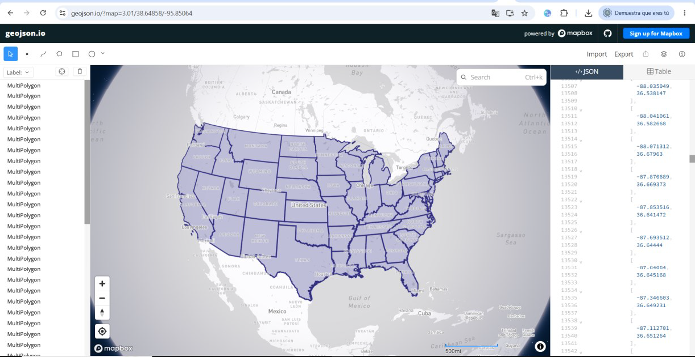

**Paso 7\. Aplicar un filtro CQL para obtener solo algunos elementos**

Los filtros CQL (*Common Query Language*) permiten realizar consultas personalizadas dentro del WFS, por ejemplo, filtrar un registro por atributo.

Vamos a consultar únicamente el estado de *California* usando un filtro CQL:

[http\://localhost:8080/geoserver/wfs?service=WFS\&version=1.0.0\&request=GetFeature\&typeName=topp:states\&outputFormat=application/json\&cql\_filter=STATE\_NAME=%27California%27](http://localhost:8080/geoserver/wfs?service=WFS&version=1.0.0&request=GetFeature&typeName=topp:states&outputFormat=application/json&cql_filter=STATE_NAME=%27California%27)

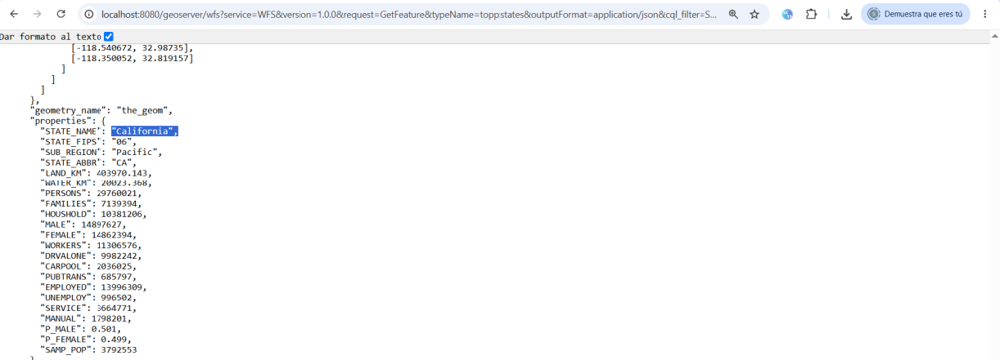

[https\://geojson.io/](https://geojson.io/)  

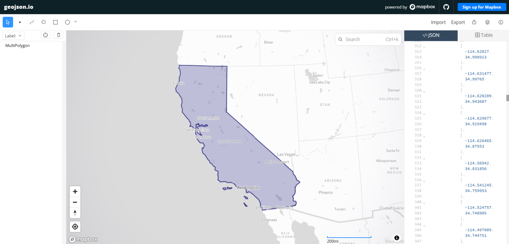

QGIS:  se conecta un servicio a través de crea una nueva conexión WFS 

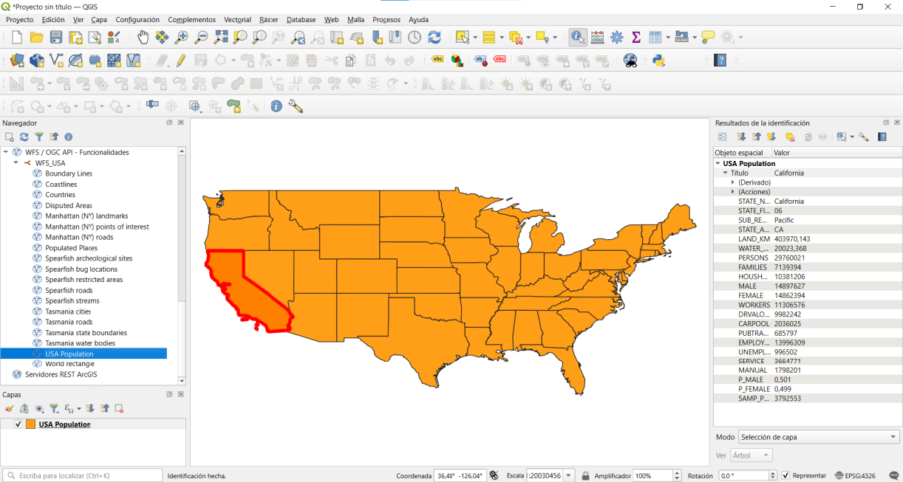

Compara el tamaño de respuesta entre WMS y WFS

### **Comparación del Tamaño de Respuesta: WMS vs. WFS**

 

| Característica / Parámetro | WMS (Web Map Service) | WFS (Web Feature Service) |
| :---- | :---- | :---- |
| Naturaleza del dato | Imagen rasterizada estática (ej. formatos image/png, image/jpeg). | Datos vectoriales puros estructurados (ej. GeoJSON, GML). |
| Tamaño de la respuesta | Fijo y optimizado para visualización rápida. El peso en bytes depende únicamente de las dimensiones de la pantalla o cuadro configurado (width y height), sin importar si en el mapa se visualizan 10 o 10,000 polígonos. | Variable y proporcional al volumen de información. Su peso depende directamente de la cantidad de registros (*features*), la complejidad geométrica (número de vértices de los polígonos) y los atributos alfanuméricos consultados. |
| Uso de filtros (CQL) | No reduce de forma directa el peso del archivo de imagen resultante, ya que el servidor siempre devuelve el cuadro ráster renderizado del área solicitada. | Reduce drásticamente el tamaño de la respuesta. Al aplicar un filtro (por ejemplo, consultar únicamente cql\_filter=STATE\_NAME='California'), el tamaño del archivo GeoJSON se reduce a una fracción mínima porque solo transmite la geometría y atributos del elemento solicitado. |
| Propósito principal | Renderizar mapas visuales rápidos para interfaces web y visores cartográficos. | Extraer, consultar, procesar y editar geometrías y tablas de atributos del lado del cliente. |

 

El **WMS** es mucho más liviano cuando se requiere renderizar grandes volúmenes de datos geográficos para una visualización visual inmediata, ya que el servidor procesa la cartografía y entrega una simple imagen. En contraste, el **WFS** transfiere toda la estructura geométrica y alfanumérica en crudo; aunque puede generar respuestas más pesadas si se consultan capas enteras, ofrece la ventaja fundamental de permitir consultas específicas mediante filtros CQL y análisis espacial directo en el cliente (como QGIS o aplicaciones web).