# Capítulo 6: Estándares para Información Geográfica

---

## 1. Abre el archivo `data/departamentos.geojson` en un editor

Se realiza la apertura y visualización de la estructura base del archivo vectorial `departamentos.geojson` en el editor de código.

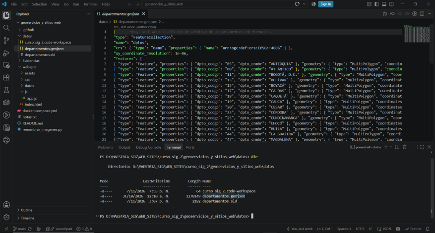

---

## 2. Identifica los elementos: `FeatureCollection`, `Feature`, `geometry`, `properties`

Dentro de la jerarquía JSON del archivo geográfico se identifican los componentes fundamentales del estándar GeoJSON:
* **`FeatureCollection`**: Contenedor principal que agrupa el conjunto de entidades espaciales.
* **`Feature`**: Cada objeto geográfico individual (en este caso, cada departamento).
* **`geometry`**: Definición espacial del objeto (`Polygon` o `MultiPolygon`) junto con su arreglo de coordenadas.
* **`properties`**: Atributos alfanuméricos asociados a cada entidad (códigos DANE, nombres, áreas, etc.).

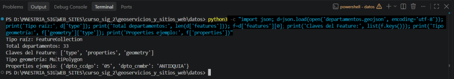

---

## 3. Cuenta cuántos departamentos hay en el archivo

Se ejecuta una consulta mediante un script de **Python** para leer el archivo GeoJSON y contabilizar el total de elementos (`features`) contenidos.

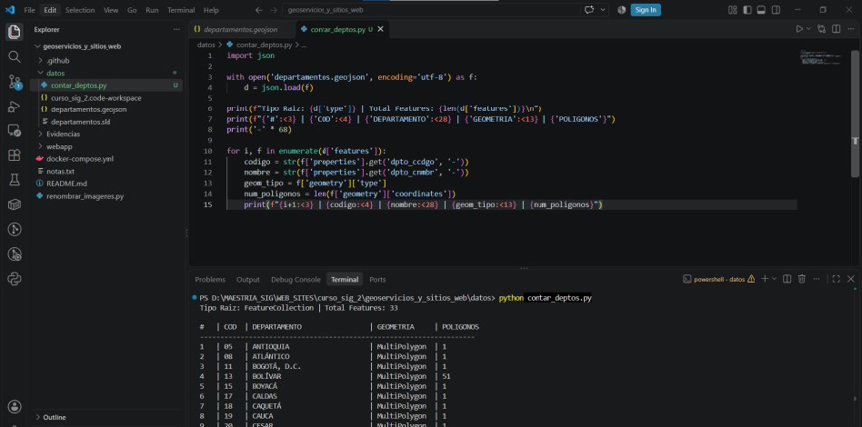

El resultado arroja el listado completo de los **33 departamentos** que conforman el territorio colombiano (32 departamentos y el Distrito Capital).

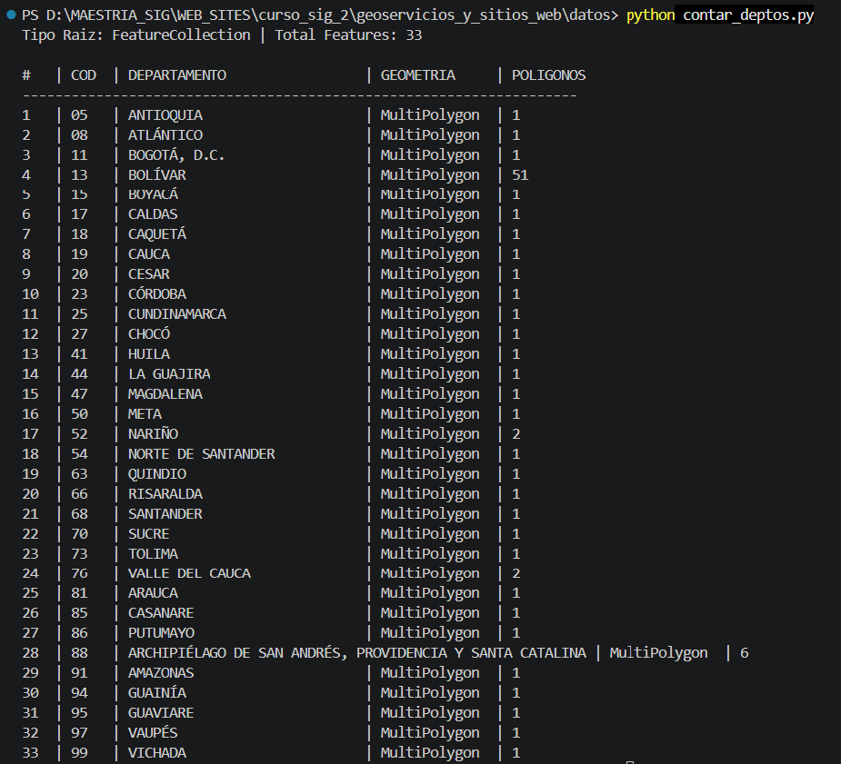

Adicionalmente, se genera automáticamente un reporte en formato Markdown (`resumen_departamentos.md`) con la consolidación de los datos extraídos.

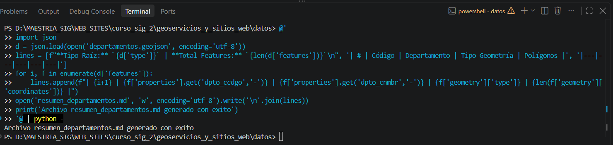

---

## 4. Abre el archivo `data/departamentos.sld` en un editor XML

Se abre el archivo de simbología `departamentos.sld` en **Visual Studio Code** para inspeccionar su estructura XML basada en el estándar *Styled Layer Descriptor* (SLD) de OGC.

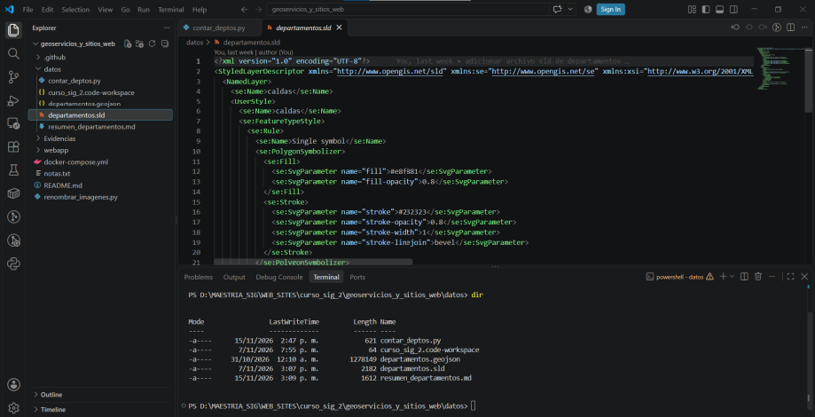

---

## 5. Identifica el color de relleno y el color del borde

Al inspeccionar el código XML dentro de la etiqueta `<se:PolygonSymbolizer>`, se identifican los parámetros de estilo configurados por defecto:

* **Color de relleno actual (`fill`):** `#e8f881`  
  Corresponde a un tono amarillo claro verdoso (lima pastel).

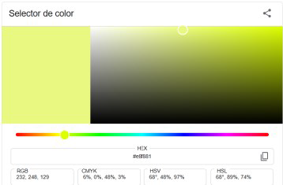

* **Color de borde actual (`stroke`):** `#232323`  
  Corresponde a un gris muy oscuro utilizado para delimitar los polígonos.

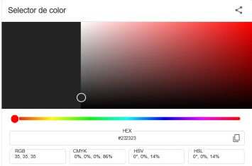

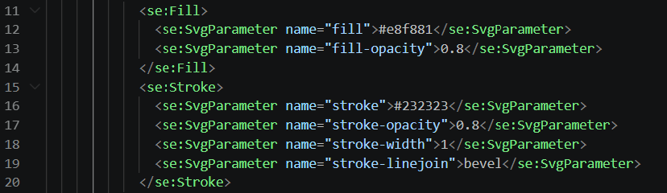

---

## 6. Modifica el color de relleno a `#FFD700` (dorado)

En el mismo archivo `departamentos.sld`, se ubica la etiqueta `<se:SvgParameter name="fill">` y se sustituye el valor hexadecimal `#e8f881` por `#FFD700` (tono dorado).

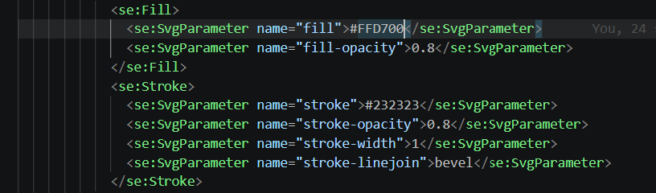

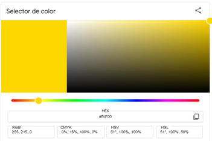

---

## 7. Cambia el tamaño de fuente de las etiquetas a `16`

Se navega dentro del documento SLD hasta la sección `<se:TextSymbolizer>` encargada del etiquetado de la capa, se localiza el parámetro `<se:SvgParameter name="font-size">` y se actualiza su valor original (`13`) a **`16`**.

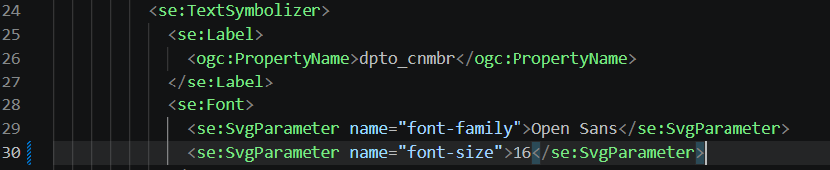

---

## 8. Valida el SLD modificado en GeoServer (y verificación visual previa en QGIS)

Previo al despliegue en GeoServer, se realiza una validación sintáctica y visual cargando el archivo `departamentos.sld` en **QGIS**:

1. **Cargar la capa:** Se añade `departamentos.geojson` al espacio de trabajo de QGIS.
2. **Importar el estilo:** Clic derecho sobre la capa $\rightarrow$ **Propiedades** $\rightarrow$ pestaña **Simbología** $\rightarrow$ menú desplegable **Estilo** $\rightarrow$ **Cargar estilo...** y se selecciona el archivo `departamentos.sld` editado.
3. **Verificación visual:** Al aplicar los cambios sin errores de lectura XML, los polígonos adoptan el relleno dorado (`#FFD700`) y las etiquetas se renderizan con tamaño `16`, confirmando que la estructura del SLD es válida.

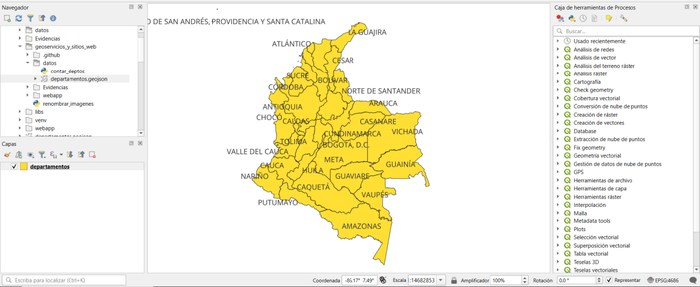