**Capítulo 7: Carga de Datos a PostgreSQL**

Primero se activa el servicio de postgres a través de la terminal de Ubuntu:

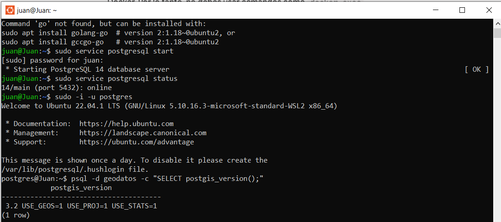

**1. Carga los shapefiles de departamentos y municipios usando shp2pgsql**

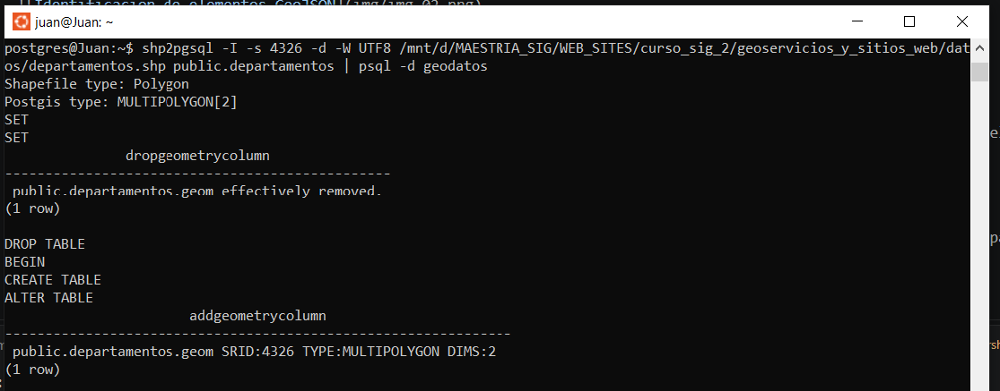

Ahora realizamos lo mismo para la capa de municipios:

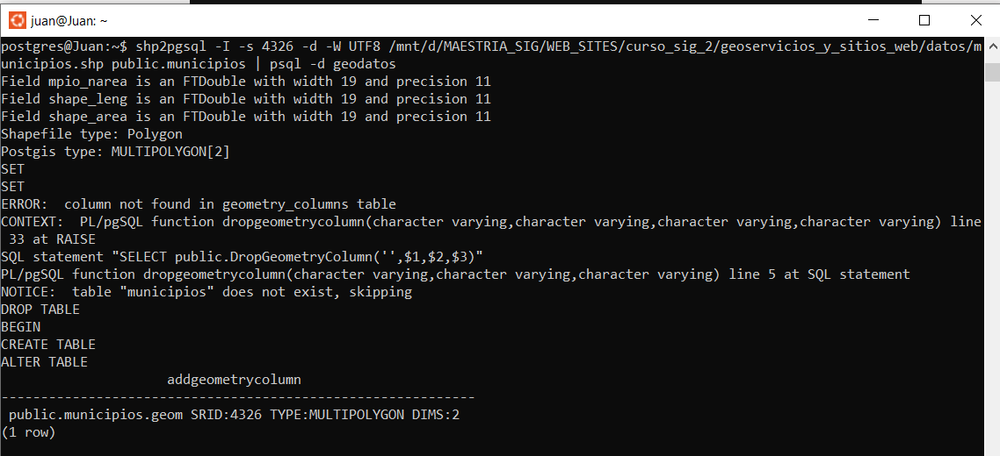

**2. Verifica que los datos se cargaron correctamente**

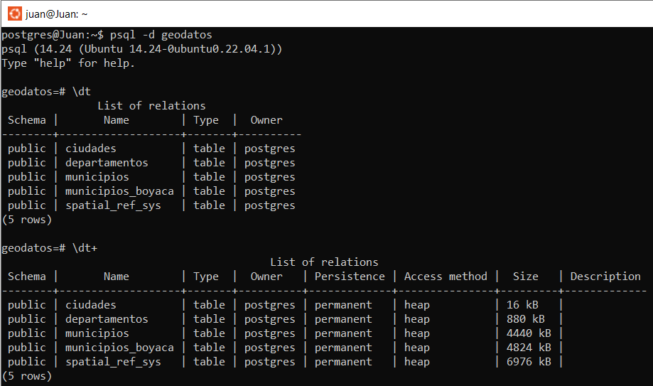

Verificamos la estructura de la capa de Departamentos:

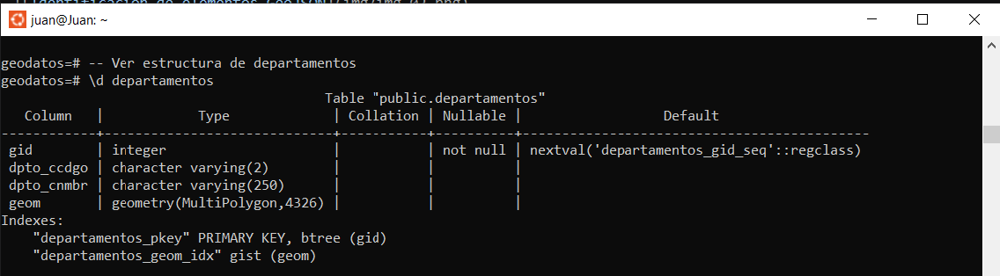

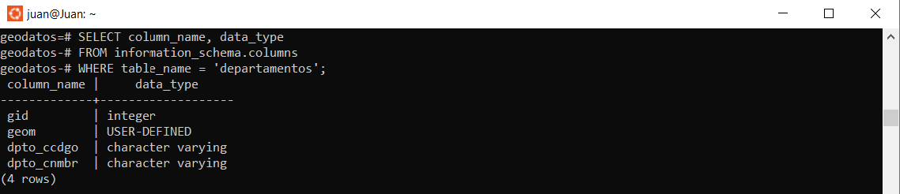

Verificamos la estructura de la capa de Municipios:

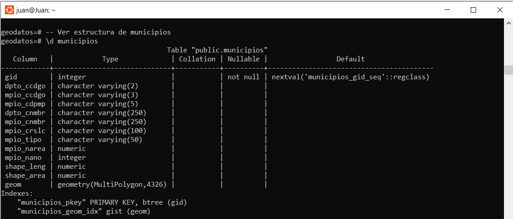

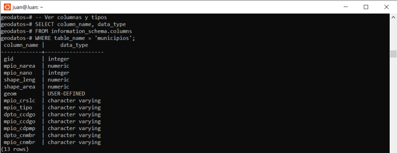

**3. Cuenta el número de registros en cada tabla**

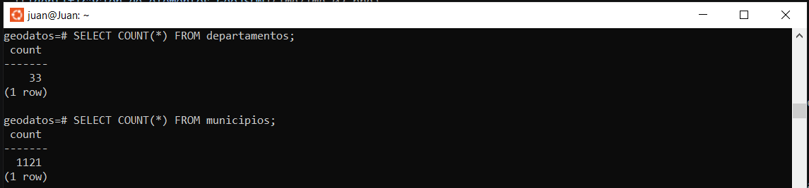

**4. Verifica que todas las geometrías son válidas**

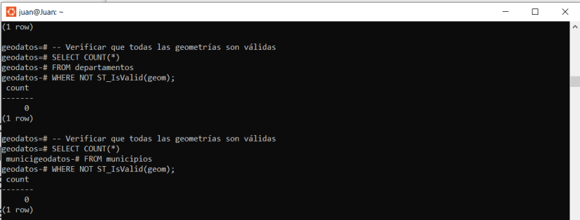

**5. Crea índices espaciales si no existen**

Departamentos:

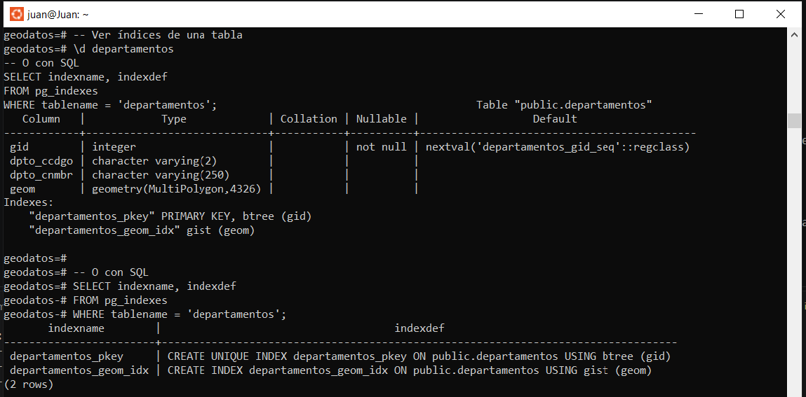

Municipios:

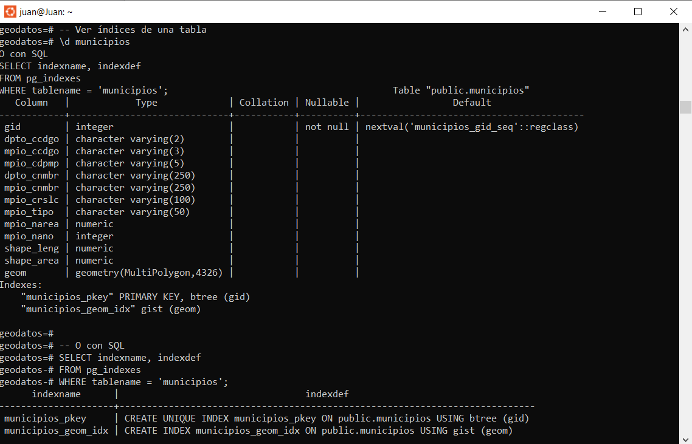

Las capturas evidencian **0 geometrías inválidas y 0 nulas** en las dos tablas. Los índices espaciales ya estaban creados: `departamentos_geom_idx` y `municipios_geom_idx`, ambos de tipo **gist (`geom`)**. No fue necesario recrearlos ni ejecutar reparaciones.

**6. Calcula el área del departamento más grande**

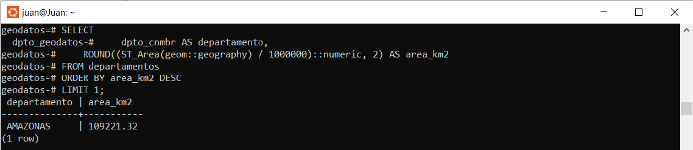

**7. Lista los 5 departamentos con más municipios**

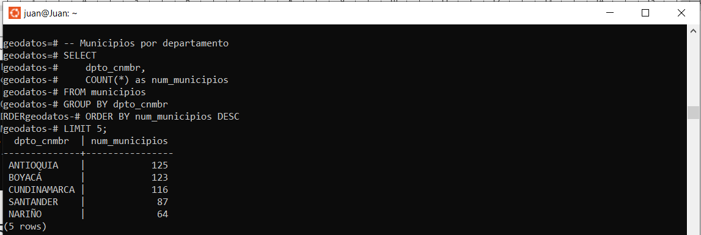

**8. Encuentra el municipio que contiene el punto [-74.0721, 4.7110] (Bogotá)**

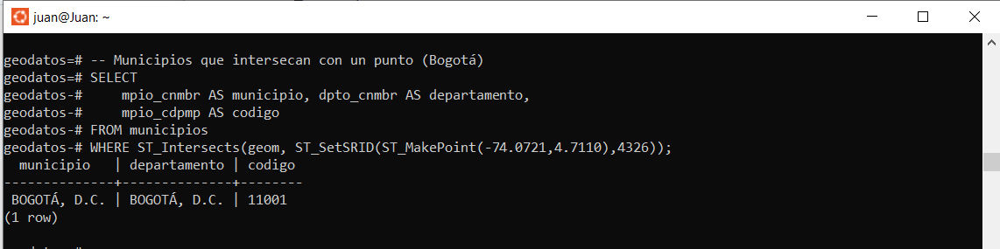

**9. Actualiza las estadísticas de las tablas**

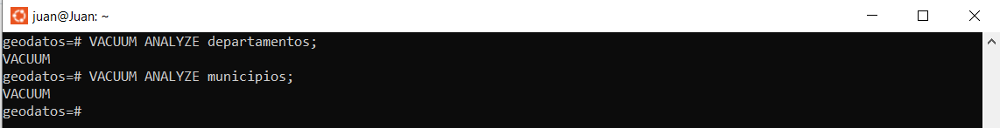

**10. Exporta los departamentos a GeoJSON**

Exportar a GeoJSON usando `ogr2ogr` (desde el host): Se presentaron problemas al tratar de hacer el procedimiento con este paso, ya que no fue posible validar la clave que solicitaba la consola para proceder con la instalación.

Por lo anterior se optó por la siguiente ruta:

### **Exportar directamente mediante SQL (Sin instalar herramientas adicionales)**

Para no instalar paquetes adicionales en este momento en Ubuntu, se procedió a ejecutar la exportación de manera nativa mediante una consulta SQL dentro de `psql`.

1. Entra a tu base de datos:

```bash
psql -d geodatos
```

2. Ejecuta la siguiente consulta para volcar la tabla departamentos a un archivo GeoJSON:

```sql
COPY (
    SELECT jsonb_build_object(
        'type', 'FeatureCollection',
        'features', jsonb_agg(feature)
    )
    FROM (
        SELECT jsonb_build_object(
            'type', 'Feature',
            'geometry', ST_AsGeoJSON(geom)::jsonb,
            'properties', to_jsonb(row) - 'geom'
        ) AS feature
        FROM (SELECT * FROM departamentos) row
    ) features
) TO '/tmp/departamentos_export.geojson';
```

3. Sal de la consola de PostgreSQL escribiendo:

```sql
\q
```

4. Copia el archivo resultante desde la carpeta temporal hacia el directorio de tu proyecto en tu disco:

```bash
cp /tmp/departamentos_export.geojson /mnt/d/MAESTRIA_SIG/WEB_SITES/curso_sig_2/geoservicios_y_sitios_web/datos/departamentos_export.geojson
```

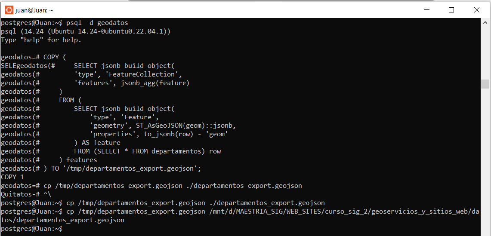

*Verification:* Se verifica que el archivo se copió correctamente listando el contenido de la carpeta de datos con:

```bash
ls -la /mnt/d/MAESTRIA_SIG/WEB_SITES/curso_sig_2/geoservicios_y_sitios_web/datos/
```

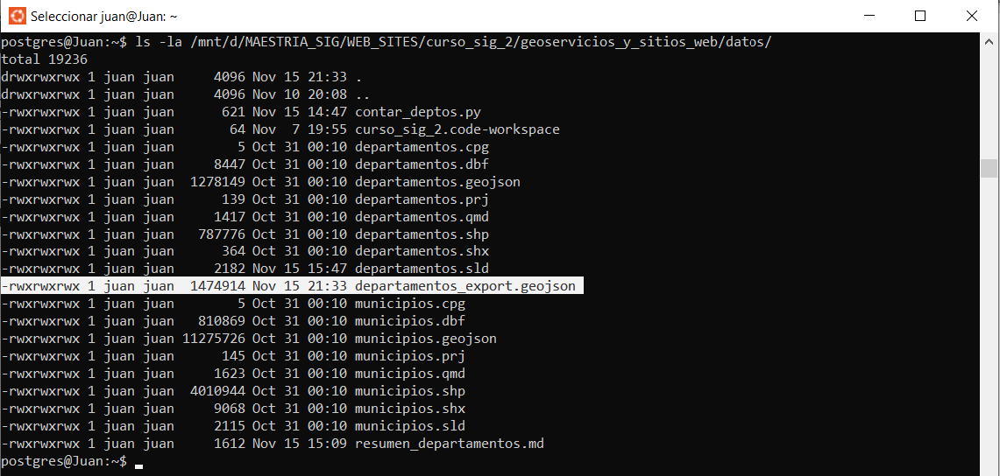

En QGIS, verificamos la capa recién creada denominada: **departamentos_export.geojson**

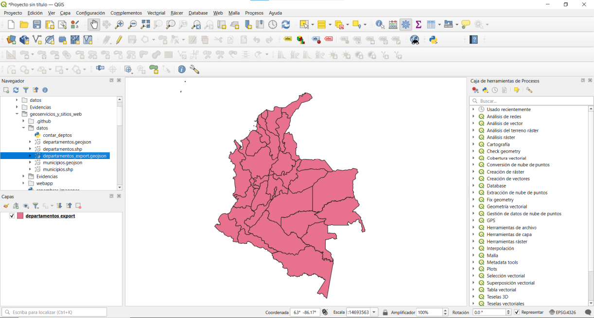
